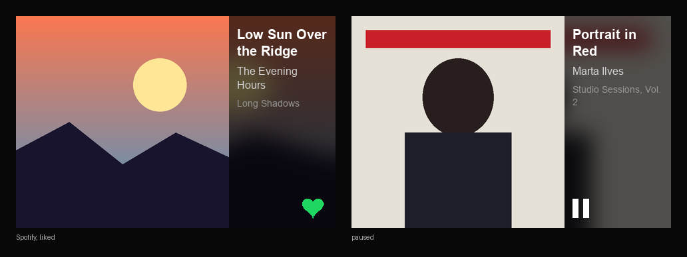
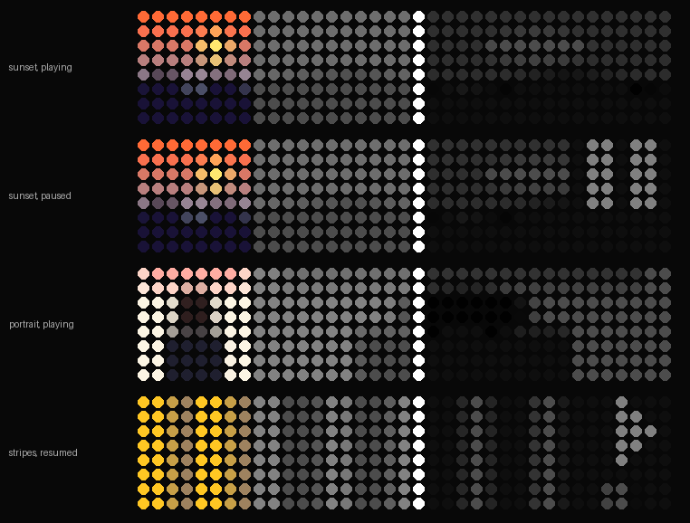

# PiTFT Now Playing

Shows BluOS / Spotify Connect cover art on a PiTFT 3.5". Tap left = previous, center = play/pause, right = next. Swipe left = next, swipe right = previous. Backlight turns off after 10 min paused; first tap wakes it.

Runs on Raspberry Pi OS Bullseye, no desktop needed.

## Preview



Made-up covers, drawn by the real render code: a Spotify track that's in your liked songs (left), and a paused track (right). The cover fills the left square; the blurred backdrop and track details fill the rest. Regenerate this and the LaMetric preview with `python3 preview.py`.

## Setup

PiTFT driver (the current Adafruit script is Bookworm-only, so use an older version):

```bash
git clone https://github.com/adafruit/Raspberry-Pi-Installer-Scripts.git
cd Raspberry-Pi-Installer-Scripts && git checkout 9086294
sudo -E env PATH=$PATH python3 adafruit-pitft.py --display=35r --rotation=270 --install-type=console
```

Dependencies, and stop the console drawing over the art (run over SSH):

```bash
sudo apt install python3-pil python3-numpy python3-evdev python3-requests
sudo systemctl mask --now getty@tty1
sudo sed -i 's/$/ vt.global_cursor_default=0/' /boot/cmdline.txt
```

Check touch zones (Ctrl-C to quit). If left/right are swapped, add `--touch-invert`. If top/bottom changes the zone, add `--touch-axis y`.

```bash
sudo python3 ~/pitft-nowplaying/nowplaying.py --calibrate
```

Set `--host` and any touch flags in `nowplaying.service`, then:

```bash
sudo cp ~/pitft-nowplaying/nowplaying.service /etc/systemd/system/
sudo systemctl enable --now nowplaying
```

Logs: `journalctl -u nowplaying -f`

## Spotify like button (optional)

Shows a heart in the bottom-right corner while Spotify plays; tap it to like / unlike. Needs Spotify Premium.

1. At [developer.spotify.com/dashboard](https://developer.spotify.com/dashboard), create an app: redirect URI `http://127.0.0.1:8888/callback`, API "Web API". Copy its Client ID.
2. On the Pi: `sudo python3 ~/pitft-nowplaying/nowplaying.py --spotify-login <CLIENT_ID>` and follow the prompts. This saves `spotify.json` next to the script.
3. Run `--calibrate` and tap the bottom-right corner: it should say `like`. If it doesn't, add `--touch-invert-v`.
4. `sudo systemctl restart nowplaying`

## LaMetric TIME (optional)

`lametric.py` mirrors the player on a LaMetric TIME (37×8): the cover as 8×8 pixels on the left, a progress bar along the bottom of the right side. It streams raw pixels (LaMetric's Streaming API, tested on firmware 3.2.8), so nothing needs installing on the clock. After 30 s paused it hands the display back to the clock's own apps.

1. In the LaMetric phone app, copy the clock's API key from its device settings.
2. Put the clock's IP and key in `lametric.service`, then:

```bash
sudo cp ~/pitft-nowplaying/lametric.service /etc/systemd/system/
sudo systemctl enable --now lametric
```

It also accepts button webhooks on port 5000 (GET or POST, unauthenticated, so LAN only): `/btn/next`, `/btn/prev`, `/btn/toggle`. Logs: `journalctl -u lametric -f`

### Preview



A mockup with made-up covers, not a photo of the clock. Left: the cover averaged down to 8×8. Right: the same cover in greyscale, stretched dim across the whole block, which doubles as a full-height progress bar: played columns are lifted lighter, a 1 px white column marks the current position. A play/pause icon sits in the corner. Tune it with `--wash`, `--past`, `--head`, `--icon` (0–1, 0 turns that part off) and `--saturation`.

## Restore the console

```bash
sudo systemctl disable --now nowplaying
sudo systemctl unmask getty@tty1
sudo systemctl enable getty@tty1
sudo sed -i 's/ vt.global_cursor_default=0//' /boot/cmdline.txt
sudo reboot
```

Autologin comes back too, if it was on.

## Options

| Option | Default | |
|---|---|---|
| `--host` | `NODE2iWohnzimmer.local` | BluOS player. Find yours with `avahi-browse -rt _musc._tcp` |
| `--fb` | autodetect | Framebuffer, e.g. `/dev/fb1` |
| `--touch-axis` | `x` | Touch axis that runs left to right |
| `--touch-invert` | off | Swap left/right zones |
| `--touch-invert-v` | off | Swap top/bottom (for the like button) |
| `--spotify-login ID` | | One-time Spotify login for the like button |
| `--idle-off` | `600` | Seconds before backlight off (`0` = never) |
| `--calibrate` | | Print tap zones |
| `--png FILE` | | Render a screenshot and exit |
